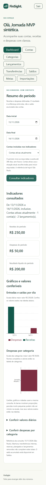

# Roteiro integrado do MVP

Este roteiro usa somente dados fictícios e demonstra o que já pode ser feito
pela interface. Não é necessário fornecer extratos reais ou credenciais bancárias.
As instruções de execução local estão no [README](../README.md).

## Preparar a conta e o CSV

1. Crie um acesso fictício e entre no FinSight.
2. Em **Contas**, cadastre uma conta corrente com saldo inicial de **R$ 1.000,00**.
   Escolha uma abertura pelo menos três dias anterior a hoje.
3. Em **Categorias**, crie uma categoria de receita e outra de despesa.
4. Prepare um CSV UTF-8 com duas linhas, uma receita de **R$ 250,00** e uma
   despesa de **R$ 50,00**, ambas posteriores à abertura e anteriores a hoje.

Exemplo com datas fictícias (adapte-as à data atual antes de usar):

```csv
Date;Description;Amount
2026-11-13;Receita sintética;250.00
2026-11-14;Despesa sintética;-50.00
```

Para esse exemplo, a abertura pode ser 2026-11-12. As datas do roteiro automatizado
são calculadas em São Paulo: abertura há três dias, receita há dois e despesa ontem.

## Importar, revisar e confirmar

Em **Importações**, selecione a conta, envie o arquivo e clique em **Analisar
arquivo**. Mapeie as colunas de data, descrição e valor, com datas ISO e valores
com ponto decimal. **Guardar prévia para revisão** ainda não cria lançamentos.

Revise cada registro, atribua sua categoria de receita ou despesa e selecione os
dois explicitamente. Abra a confirmação, confira valores/avisos e marque as três
ciências. Confirme uma vez e confira o recibo: **dois lançamentos criados**.
Transferências e estornos exigem revisão manual; não os trate como receita ou
despesa apenas pelo sinal do valor.

## Conferir indicadores e saldo

No **Dashboard**, escolha o período que contém as duas datas. Os resultados
esperados são receita **R$ 250,00**, despesa **R$ 50,00** e resultado líquido
**R$ 200,00**, com dois lançamentos. Os gráficos e as tabelas usam esses mesmos dados.

Em **Saldos**, consulte a posição na data da despesa ou posteriormente. O saldo
consolidado esperado é **R$ 1.200,00**: abertura de 1.000 mais resultado de 200.
O resultado do período não é o saldo acumulado. A lista de contas mostra a posição
inicial; para a posição calculada use a consulta de saldos, com data explícita.

## Acompanhar uma meta

Em **Metas**, crie um objetivo de **R$ 200,00**. Abra **Reservas e progresso**,
escolha a conta e reserve **R$ 100,00**. Confira progresso de **50,00%**, saldo
bancário de **R$ 1.200,00** e saldo livre de **R$ 1.100,00**.

Consulte o saldo novamente na data da reserva: continua **R$ 1.200,00**. Consulte
o Dashboard desde a receita até a data da reserva: receita/despesa/resultado
continuam **250/50/200**. Reservar compromete dinheiro, sem criar uma despesa ou
reduzir o saldo bancário. Saia da sessão ao terminar.

## Evidência reproduzível e pendências

Captura do cenário automatizado, em tela de 320 pixels com fonte ampliada.
Nome, conta e valores são fictícios; a imagem mostra o resultado do período,
que é diferente do saldo bancário acumulado:



O cenário [mvp-journey.spec.ts](../tests/auth-browser/mvp-journey.spec.ts) percorre
todas essas etapas pela interface, sem preparar usuário, conta, categorias,
importação ou meta diretamente pela API. A automação cria API/PostgreSQL
descartáveis próprios e não usa o banco pessoal. Para executar apenas esse fluxo:

```powershell
npm run test:auth -- --project=session-browser tests/auth-browser/mvp-journey.spec.ts
```

O ambiente de demonstração do [PR #31](https://github.com/joaobagatim/FinSight/pull/31)
é uma entrega separada, ainda não integrada à `main` no momento desta auditoria.
Não confunda o roteiro reproduzível da automação com uma demo publicada ou em
produção. A atualização dessa demo e a medição de desempenho em referência
definida continuam pendentes; tempos de testes não constituem benchmark nem SLA.
